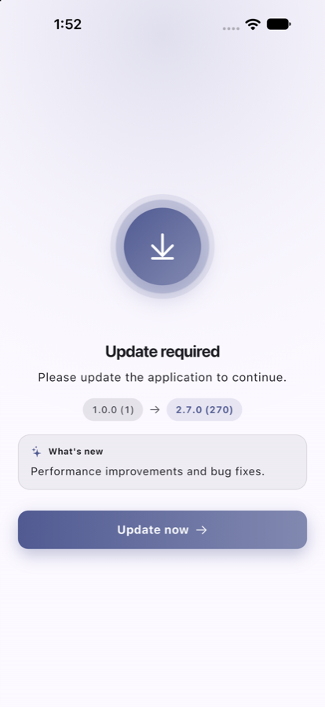
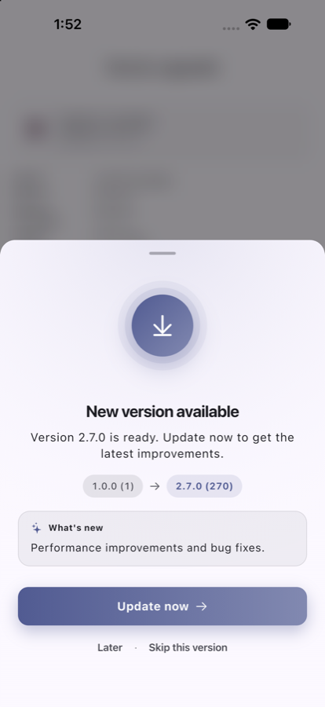
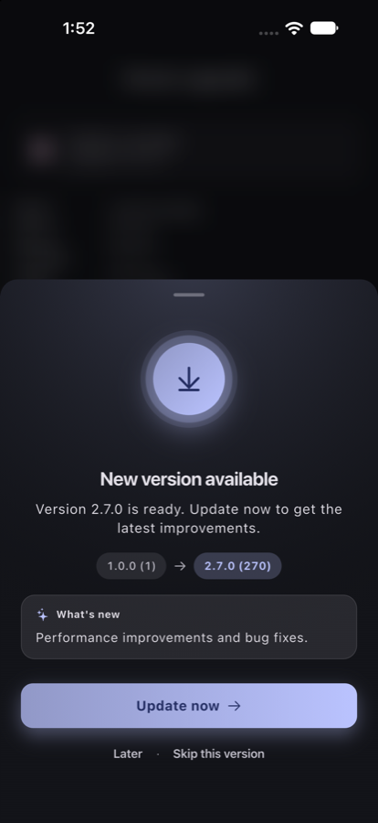

# flutter_app_version_upgrader

[](https://pub.dev/packages/flutter_app_version_upgrader)
[](https://github.com/sadiqueiqbal0786/flutter_app_version_upgrader/actions/workflows/ci.yml)


[](LICENSE)

Remote-controlled app version management for Flutter, by [Sadique Iqbal](https://github.com/sadiqueiqbal0786).

The plugin asks your version API which release is the **latest** and which is
the **minimum** an administrator still allows, compares both against the
installed version, and hands back a decision. It never shows UI, so the same
plugin works in any app.

```text
STORE          →  latest published version      (discovered automatically)
ADMIN POLICY   →  minimum supported version     (defaults to latest, can be pinned)
PLUGIN         →  UP_TO_DATE | UPDATE_AVAILABLE | UPDATE_REQUIRED | CHECK_FAILED
```

## Features

- Proper semantic version comparison (`2.10.0 > 2.9.0`), with pre-release
  precedence and build numbers as a tie-breaker.
- Policy modes from the backend: `auto_latest`, `custom`, `age_based`.
- Separate **latest**, **recommended** and **minimum** versions.
- Channels (`production`, `beta`, `alpha`, `internal`) baked into every
  request and cache key, so production users never see beta data.
- Last-known-good cache in native storage with a TTL, used when the API is
  down. Fail-open by default, fail-closed if you choose.
- Opens the Play Store / App Store page, preferring the URL the backend
  returns.
- Optional built-in UI (`ui.dart`): themeable, platform-adaptive update
  page and Update / Later / Skip sheet, with full builder overrides.
- Pluggable response validation hook for signed responses.
- No store credentials or secrets in the app.

## Platform support

| Platform | Support |
|---|---|
| Android | Native (`minSdk 24`) |
| iOS | Native (iOS 15+) |
| Web, macOS, Windows, Linux | Guarded fallback: no exception is thrown. `check()` returns `checkFailed` and fails open unless you set `appId` and `currentVersionOverride`, in which case the check runs with an in-memory cache. `openStore` returns `false`. |

`VersionManager.isPlatformSupported` tells you at runtime which case you are in.

## Install

```yaml
dependencies:
  flutter_app_version_upgrader: ^0.2.1
```

Android needs `minSdk 24`; iOS needs 15.0.

## Usage

```dart
import 'package:flutter_app_version_upgrader/flutter_app_version_upgrader.dart';

await VersionManager.initialize(
  const VersionManagerConfig(
    baseUrl: 'https://versions.example.com',
    channel: VersionChannel.production,
    apiKey: 'public-client-key',          // optional, sent as X-Api-Key
    appStoreId: '123456789',              // optional iOS fallback store link
    cacheTtl: Duration(hours: 24),
    failurePolicy: FailurePolicy.open,    // default
  ),
);

final result = await VersionManager.check();

switch (result.status) {
  case UpdateStatus.updateRequired:
    // Block the app. result.updateMessage holds the admin's text.
    await VersionManager.openStore(result);
  case UpdateStatus.updateAvailable:
    // Offer a soft update.
  case UpdateStatus.upToDate:
  case UpdateStatus.checkFailed:
    // result.isBlocked tells you whether to block on failure.
}
```

`result` carries everything the server knew, not just a verdict:

| Field | Meaning |
|---|---|
| `current` | Installed version and build |
| `latest` | Newest published release |
| `minimum` | Oldest version allowed to run |
| `recommended` | Version users are nudged towards, if any |
| `policy` | Mode, `forceUpdate`, `enabled`, `updateMessage` |
| `updateUrl` | Store page supplied by the backend |
| `source` | `network`, `cache` or `none` |
| `isStale` | Cache was past its TTL when used |
| `isBlocked` | Whether the host app should stop normal use |

### On resume

Call `VersionManager.check(preferCache: true)` on app resume. It returns the
cached policy without a network round trip while the cache is fresh, and
refreshes it otherwise.

### Dependency injection

`VersionManager` can be constructed directly with your own `http.Client`,
platform implementation and clock. The static `VersionManager.*` methods are
a convenience over a shared instance.

### Decision rules

1. Policy disabled → never `updateRequired`.
2. `current < minimum` and `policy.forceUpdate` → `updateRequired`.
3. `current < latest` → `updateAvailable`.
4. Otherwise → `upToDate`.

If the API is unreachable: use the cache (fresh, or stale when
`allowStaleCache` is on). With no cache at all: `checkFailed`, and
`isBlocked` follows `failurePolicy`.

## Built-in UI (optional)

| Update required | Update available | Dark mode |
|---|---|---|
|  |  |  |

The core library never shows UI. If you want ready-made screens, import
the UI library and wrap your app:

```dart
import 'package:flutter_app_version_upgrader/ui.dart';

MaterialApp(
  builder: (context, child) => VersionUpgrader(child: child!),
  home: const HomePage(),
)
```

That gives you, with no further code:

| Decision | What the user sees |
|---|---|
| `updateRequired` | Full-screen, non-dismissible page with the admin's message and an Update button |
| `updateAvailable` | Bottom sheet with Update, Later and Skip this version. Later snoozes for a day, Skip hides that version for good. Both are remembered across restarts |
| `upToDate`, `checkFailed` | Nothing; the app renders normally |

The default look: a gradient hero with softly pulsing rings, "installed →
latest" version chips, a release-notes card, a gradient primary button with
a coloured shadow, a blurred backdrop behind the sheet, and staggered
entrance animations. It is platform-adaptive (Material secondary buttons
on Android, Cupertino ones and tighter radii on iOS and macOS) and every
colour comes from your `Theme`, light or dark, unless you override it.

Three layers of customisation, from lightest to heaviest:

```dart
VersionUpgrader(
  // 1. Wording and localisation. {current}, {latest}, {minimum} are filled in.
  texts: const UpgraderTexts(
    availableTitle: 'Nueva versión',
    availableMessage: 'La versión {latest} ya está disponible.',
    updateButton: 'Actualizar',
    laterButton: 'Más tarde',
    skipButton: 'Omitir esta versión',
  ),
  // 2. Look: colours, radii, icon or any illustration widget, presentation.
  style: UpgraderStyle(
    accentColor: const Color(0xFF0B5FFF),
    heroGradient: const [Color(0xFF0B5FFF), Color(0xFF7C4DFF)],
    presentation: UpgraderPresentation.dialog, // or bottomSheet, fullScreen
    illustration: Image.asset('assets/update.png', height: 120), // replaces the hero
    borderRadius: BorderRadius.circular(16),
    blurBackdrop: false,
    animateHero: false,
    showVersionChips: false,
  ),
  // 3. Behaviour.
  options: const UpgraderOptions(
    initialDelay: Duration(seconds: 1),
    remindLaterAfter: Duration(days: 3),
    allowSkipVersion: false,
    softPromptOnlyBelowRecommended: true,
  ),
  // Hooks for analytics or custom navigation.
  onResult: (r) => analytics.log('version_check', r.toJson()),
  onUpdatePressed: (r) async { /* return true to handle it yourself */ return false; },
  child: child!,
)
```

To replace the widgets entirely while keeping the checking, snooze and
skip logic, pass builders:

```dart
VersionUpgrader(
  requiredBuilder: (context, result, onUpdate) => MyBlockingPage(result, onUpdate),
  availableBuilder: (context, result, onUpdate, onLater, onSkip) =>
      MySheet(result, onUpdate: onUpdate, onLater: onLater, onSkip: onSkip),
  child: child!,
)
```

`UpdateRequiredScreen`, `UpdateAvailablePrompt` and `UpgraderContent` are
exported too, so you can reuse the pieces inside your own layout.

## Backend contract

The plugin calls:

```text
GET {baseUrl}/v1/version/check?app_id=&platform=&channel=&version=&build=
```

and expects the JSON documented in [doc/api_contract.md](doc/api_contract.md).

A complete reference backend lives in [backend/](backend/): Google Play and
App Store Connect pollers, release database, policy engine
(`auto_latest` / `custom` / `age_based`), admin API and dashboard. Its
README lists the credentials you must provide. For a quick local run
without any backend, `example/tool/mock_version_server.dart` serves the
same contract.

## Security notes

- Keep Google Play / App Store Connect credentials on the server.
- Use HTTPS. Add an `X-Api-Key` or custom headers through the config.
- To verify signed responses, supply `responseValidator` and check the
  signature header against the raw body. The backend README shows the
  exact HMAC scheme and a Dart snippet.
- Certificate pinning is deliberately not built in.

## Native layer

The platform code is intentionally small:

| Method | Android | iOS |
|---|---|---|
| `getAppInfo` | `PackageManager` versionName / longVersionCode | `CFBundleShortVersionString` / `CFBundleVersion` |
| `readCache` / `writeCache` / `clearCache` | `SharedPreferences` | `UserDefaults` |
| `openStore` | `market://` then Play web URL | `itms-apps://` then App Store web URL |

## Author

**Sadique Iqbal** · [GitHub](https://github.com/sadiqueiqbal0786) · sadiqueiqbal.si@gmail.com

Issues and pull requests are welcome at the
[repository](https://github.com/sadiqueiqbal0786/flutter_app_version_upgrader).

## License

MIT © 2026 Sadique Iqbal. See [LICENSE](LICENSE).
